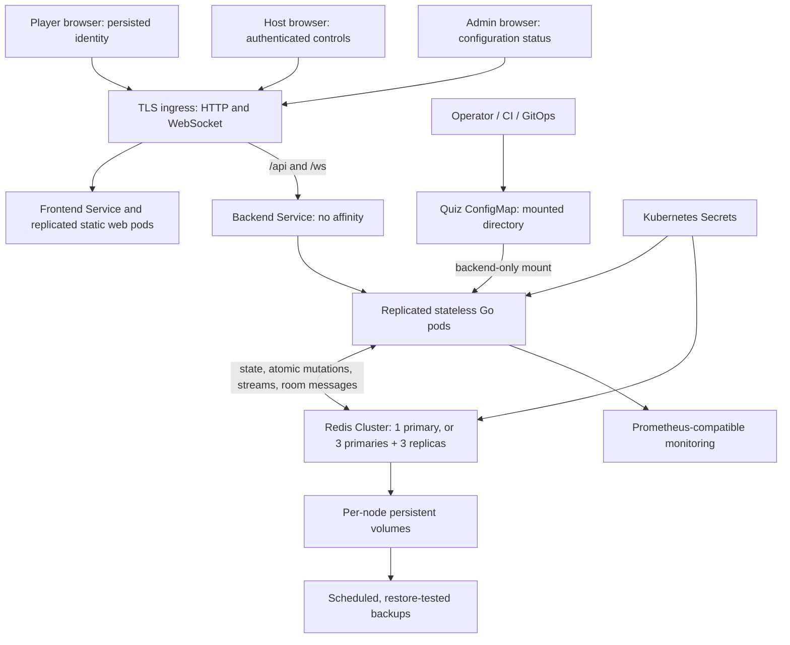

# Architecture and technical design

Status: architecture approved and application implemented. See
[Redis](redis-data-model.md), [transport](websocket-protocol.md), and the
[validation report](validation.md) for implementation choices and measured scope.

## 1. Scope and invariants

- React, TypeScript, Tailwind CSS, and Vite serve player, host, and read-only
  admin experiences with responsive layouts.
- Go serves REST, WebSocket, health endpoints, and Prometheus metrics.
- Every pod uses the same Redis Cluster. Redis owns game state, player identity,
  accepted answers, scores, deadlines, and recoverable event history.
- No sticky sessions, process-local game truth, or browser-authoritative scoring.
- Local memory may hold sockets, room subscriptions, and an immutable catalog
  cache only. Losing any pod must not lose application-owned game state.
- Quiz content originates in mounted Kubernetes ConfigMap files. The admin UI
  reports metadata and validation status; it cannot edit Kubernetes resources.
- Correct answers remain backend-only until their question has closed.

## 2. Component diagram



Kubernetes defaults to one primary owning all slots, with no automatic
failover. An opt-in component selects three primaries and three replicas;
Compose retains that six-node topology. Neither configuration alone establishes
production availability or capacity.

## 3. Source boundaries

| Location | Responsibility |
| --- | --- |
| `src/backend/cmd/api` | Dependency wiring, process startup, signals, shutdown |
| `src/backend/internal/config` | YAML loading, validation, versioning, atomic catalog replacement |
| `src/backend/internal/game` | Domain types, state transitions, scoring, repository interfaces |
| `src/backend/internal/redis` | Cluster client, persistence, Lua transactions, event distribution |
| `src/backend/internal/transport` | REST, WebSocket, authentication, rate limiting, public DTOs |
| `src/backend/internal/observability` | Structured logging, metrics, correlation IDs |
| `src/frontend/src/app` | Routes and application composition |
| `src/frontend/src/features` | Player, host, and admin experiences |
| `src/frontend/src/shared` | Event types, WebSocket manager, local identity, common UI |
| `config` | Sample quiz source; never imported into the frontend bundle |
| `deploy` | Compose development environment and Kustomize deployment structure |
| `infra` | Azure Terraform provisioned by azd (`azure.yaml`): AKS, ACR, network, monitoring, Key Vault |
| `tests` | Cross-process integration and load scenarios |

Keep Go domain logic independent of HTTP and Redis client types. Keep ordinary
unit tests beside their Go/TypeScript source; use the root tests directory for
environment-dependent tests. Select and pin supported dependencies and image
versions when their implementation phases begin, rather than inventing lockfiles
or modules in the design phase.

## 4. Authoritative game lifecycle

Proposed states:

```text
LOBBY -> QUESTION_OPEN -> QUESTION_CLOSED -> QUESTION_OPEN -> ... -> FINISHED
  \              \                  \                              |
   +--------------+------------------+----> FINISHED                v
                                                               EXPIRED
```

Session expiration also makes any earlier state inaccessible. Starting opens the
first question. Advancing requires a closed question, and advancing after the
last result finishes the game. An authenticated host may finish early.

Creation atomically reserves a cryptographically generated six-digit PIN with
bounded collision retries. PINs are routing identifiers, never authorization.
Each game also has an immutable session ID. Credentials bind to that session ID,
so PIN reuse cannot attach an old player or host to a new session.

Every transition checks the current state/revision in Redis. A stale host tab,
duplicate request, or second worker cannot independently advance the game.
Creation must support idempotency so a network retry does not create another game.

Persist question start/deadline timestamps. Submission and closure use Redis-side
time checks, not browser time or a single backend pod's timer. A distributed
deadline worker uses durable due-work discovery and idempotent closure; it must
resume after all previous workers disappear. The Phase 2 Redis contract specifies
its partitioned index and same-slot transaction layout. Client activity is not
required for a question to close.

Default scoring is the question's configured points for a correct accepted
answer and zero otherwise. No speed bonus or answer edits in the initial scope.
Ties share a rank; stable secondary ordering is for display only.

Proposed configurable expiration defaults: two hours idle, 24 hours absolute
lifetime, and one hour result retention, without exceeding the absolute limit.
Application timestamps enforce expiry even before physical Redis key cleanup.
Room data, credentials, history, and scheduler entries follow the same policy.

## 5. Quiz configuration and immutable game versions

1. Mount the whole configuration directory read-only into backend pods, without
   `subPath`. Poll file content periodically, accounting for volume symlink swaps.
2. Read the complete candidate and validate schema, unique IDs, allowed types,
   option IDs, correct-answer references, positive durations/points, and size limits.
3. Normalize the validated content and compute a deterministic content version.
4. Atomically replace the local immutable catalog only after full validation.
   Invalid startup configuration prevents readiness; invalid reloads preserve
   the last known-good catalog and report sanitized validation errors.
5. On game creation, persist the selected full quiz snapshot and version with the
   game, including backend-only answers. All subsequent operations use that
   snapshot, never a pod's current catalog.

Redis stores runtime snapshots, not the administrative source of quiz content.
A new pod can therefore resume a game even if its mounted catalog has changed.
Catalog propagation may temporarily differ across pods; clients select a quiz
with its expected version, and creation rejects a version mismatch for refresh.
Expose per-pod active version and reload status through authenticated admin
responses and operational metrics; do not imply cluster-wide synchronous reload.

Kubernetes volume updates are eventual and applications must detect changes;
`subPath` mounts do not receive ConfigMap updates. See official source [K1].

## 6. Redis state, atomicity, and distribution

Use the Go Redis Cluster client with multiple discovery addresses, bounded pool
sizes, operation deadlines, retry limits, authentication, and environment-specific
transport security. Never silently fall back to a local map on Redis failure.

The Phase 2 Redis contract defines keys, TTLs, scripts, and scheduler partitions.
Related keys must share a Redis Cluster hash tag for multi-key atomic commands
[R1]. Choose a bounded coordination partition per game so a durable due-work
index can share its slot; avoid one global hash tag that puts every game on one
primary.

An accepted-answer transaction validates session membership, question/revision,
deadline, option, and prior answer; then stores the answer, updates the sorted-set
leaderboard once, increments room revision, and appends durable events together.
All business validation must precede writes: Lua atomic execution is not rollback.
Retries return the original accepted outcome, never increment score twice.
Public answer acknowledgments reveal acceptance only; correctness and scores are
withheld until closure, including reconnect snapshots and leaderboard projections.

Use room-scoped Redis Pub/Sub as a low-latency notification layer, bounded
Redis Streams for change journaling, and authoritative snapshots for recovery.
Pub/Sub is at-most-once,
not durable [R2]. Commit durable state/history first; notification failures are
repaired by periodic revision reconciliation, not by assuming publication worked.
Each pod subscribes only to rooms with local clients. A shared per-pod room reader
coalesces notifications and atomically reads durable state for fan-out; it does
not load-balance delivery using Redis consumer groups.

Subscribe before obtaining the room reader's first snapshot, then deliver
newer snapshots. Detect revision regression,
resynchronize after Redis reconnect, and reconcile periodically even when a lost
notification is the last event. Lagging clients receive a fresh snapshot when
history has been trimmed. Disconnect bounded-queue slow clients for recovery
instead of allowing unbounded memory growth.

Guarantee idempotent business effects and recoverable state, not exactly-once
network delivery. Redis Cluster uses asynchronous replication, so failover may
lose acknowledged writes under some failures [R1]. Persistence/replicas/backups
reduce risk but do not establish zero data loss. Phase 7 must document this
durability boundary and restore procedure; Phase 9 measures actual recovery.

## 7. Identity, reconnection, and authorization

- Generate a UUID v4 player ID with browser cryptographic APIs on the first visit.
- Before joining, generate a cryptographically random reconnect token of at least
  256 bits. Persist `player_id`, `player_name`, `game_pin`, and `reconnect_token`
  locally before sending, so a lost join acknowledgment can be retried safely.
- Redis stores a token digest, never the raw token. Player ID alone is insufficient.
  Bind membership and digest to the immutable game session ID. Never broadcast
  credentials, send them in URLs, or put them in logs.
- Retry a first join with the same credentials idempotently; reject an existing
  player ID with a different token. A valid reconnect restores the same membership,
  score, current question, answer status, and room state on any pod.
- A new authenticated socket gets a Redis-backed connection generation. Old
  sockets cannot submit or leave after replacement. Network disconnect does not
  remove the player; explicit leave is a separate authorized, idempotent command.
- Use exponential reconnect backoff with full jitter and a configurable cap,
  initially 30 seconds. Show connecting, connected, recovering, and offline states.
  Reset backoff only after successful recovery. Recover from snapshots, not
  optimistic local scores or blind replay of uncertain answers.
- Preserve local credentials across refresh/network errors. Clear game fields
  only after confirmed leave or a server-confirmed expiry policy outcome, not a
  timeout, malformed response, wrong PIN, or generic authentication failure.

Proposed initial host/admin authentication is a deployment-provided administrative
credential checked by the backend, never compiled into Vite assets or saved as a
player credential. Exchange it for a short-lived HttpOnly, Secure, SameSite
session; protect state-changing cookie requests against CSRF. Issue a separate
game-scoped host capability at creation and store only its digest in Redis.
WebSocket host commands require both authenticated role and game ownership.
SSO/OIDC integration is outside the initial implementation scope.

Validate WebSocket Origin, all message schemas and sizes, player-name length,
and game PIN shape. Treat names as plain text in React; never render them as HTML.
Use Redis-backed per-IP join limits and per-membership submission limits, with
bounded key cardinality and only trusted-ingress forwarded addresses.

## 8. Transport and UI boundaries

REST handles public quiz metadata, authenticated configuration status, session
creation, and operational endpoints. WebSocket handles joining, answering,
reconnecting, leaving, host start/advance/end commands, and all live state updates.
The Phase 2 transport contract defines routes, payloads, errors, and compatibility.

Every event carries an ID, type, protocol version, game PIN, timestamp, payload,
and player ID when applicable. Server events also carry session ID and monotonic
room revision; client command IDs support deduplication. Use explicit allowlisted
DTOs per audience rather than serializing internal quiz/session structs.

The player sees PIN/name entry, lobby, synchronized question countdown, answer
confirmation, closed-question result, score, leaderboard, and recovery status.
Countdown is presentation derived from a server deadline, not permission to answer.
The host sees quiz selection, room PIN and QR join URL, roster, questions, answer
statistics after closure, controls, leaderboard, and final results.
The read-only admin sees quiz metadata, versions, and validation status.

## 9. Deployment and operations

Use Kustomize base resources with development and production overlays. Ship
separate frontend/backend images and a multi-node local Redis Cluster in Compose;
local integration must not substitute standalone Redis for cluster behavior.

Kubernetes targets:

- Replicated frontend/backend Deployments and Services with rolling updates,
  explicit resource requests/limits, HPA, disruption budgets, and topology spread.
- Redis StatefulSet-based nodes with stable discovery, cluster bootstrap,
  one primary by default or optional three primaries/three replicas, persistent
  volumes, authentication, persistence,
  anti-affinity, and documented node replacement/recovery. StatefulSets provide
  persistent identity/storage primitives, not Redis cluster management [K2].
- Scheduled backups with protected credentials, retention, off-cluster storage
  configuration, and a tested cluster-consistent restore procedure.
- TLS ingress with controller-specific WebSocket support/timeouts, no correctness
  dependency on affinity, and same-origin application/API routing.
- Directory-mounted quiz ConfigMap, externally supplied Secrets, least-privilege
  ServiceAccounts, and no backend Kubernetes API permission just to read files.
- Default-deny NetworkPolicies with explicit ingress, DNS, backend-to-Redis,
  Redis client/cluster-bus replication, monitoring, and backup paths.
- Non-root containers, read-only root filesystems where possible, and no
  frontend mount of quiz files or infrastructure credentials.

Provide `/healthz`, `/livez`, `/readyz`, and `/metrics`. Liveness reports process
health without depending on Redis; readiness requires a valid catalog and usable
Redis Cluster. Startup probes allow bounded initialization. On SIGTERM, fail
readiness, reject new upgrades, notify/close existing sockets for reconnect,
finish bounded in-flight operations, and exit within the pod grace period.

Use structured JSON logs and correlation IDs across HTTP, commands, and events.
Record session/game identifiers when useful, never credentials. Metrics cover
connections, Redis-backed active membership/games, answer/Redis latency, rejected
commands, reconnection outcomes, event lag, reload health, and dropped queues.
Avoid player IDs and game PINs as unbounded Prometheus labels.

## 10. Verification strategy and open approval points

Unit tests cover configuration validation/replacement, lifecycle, DTO redaction,
scoring, input validation, and reconnection/backoff behavior.
Real-cluster integration tests cover simultaneous submissions, idempotency,
version-pinned sessions, cross-pod fan-out, history gaps, and deadline recovery.
Browser tests cover reload and persisted identity. k6 covers concurrent rooms,
join bursts, submissions, connection capacity, and recovery under load.
Failure tests explicitly terminate pods and Redis primaries, with assertions on
identity, authoritative state, consistency, measured loss, and restoration.

The [validation report](validation.md) distinguishes executable checks from
unmeasured production capacity; load-script thresholds are initial test targets.
The proposed auth approach, fixed-point scoring, expiration defaults, and
Kustomize packaging are included in this design's approval gate. Production
domain/TLS issuer, storage class, backup target, retention/RPO/RTO, and capacity
targets remain environment inputs before deployment validation.

## Official technical references

Consulted November 15, 2026:

- [R1] Redis documentation, "Redis cluster specification":
  `https://redis.io/docs/latest/operate/oss_and_stack/reference/cluster-spec/`
- [R2] Redis documentation, "Redis Pub/sub":
  `https://redis.io/docs/latest/develop/pubsub/`
- [K1] Kubernetes documentation, "ConfigMaps" and "Updating Configuration via a ConfigMap":
  `https://kubernetes.io/docs/concepts/configuration/configmap/`
  `https://kubernetes.io/docs/tutorials/configuration/updating-configuration-via-a-configmap/`
- [K2] Kubernetes documentation, "StatefulSets":
  `https://kubernetes.io/docs/concepts/workloads/controllers/statefulset/`
